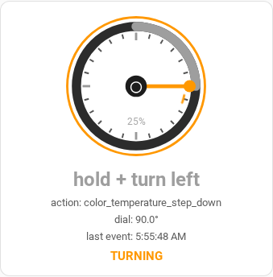

# Knob Animated Card

A fully animated Lovelace dial card for the IKEA-style Zigbee rotary knob
(Hue Tap dial / Tuya TS004F / ZG-101ZD and friends) in
[Home Assistant](https://www.home-assistant.io/).



The needle sweeps smoothly as you turn, the arc fills in the gesture's
colour, and the card flashes, spins and pulses with what your hand is doing —
all live, with no page refresh.

## Why a custom card?

Home Assistant's **markdown card cannot animate anything** — this is
structural, not a bug. Dashboard markdown is rendered through `marked` +
`filterXSS` (js-xss) with Home Assistant's whitelist, and the call passes **no
CSS filter**, so every `style="..."` attribute is silently dropped. SVG support
is further gated behind an `allow-svg` flag that the markdown card never sets,
so `<svg>` and `<style>` blocks render as escaped text. Two live experiments
confirmed it: styled `<div>` dials paint as unstyled text, inline SVG shows up
as literal markup.

The sanctioned escape hatch is a real custom card: an `HTMLElement` with
shadow DOM, where your own `<style>`/SVG/CSS keyframes run natively, outside
the sanitizer. That's what this is — one self-contained
`knob-animated-card.js`, no build step, no dependencies.

## Features

- **Smooth-sweep needle** — CSS transition on rotation, so every detent click
  glides instead of jumping.
- **Wrap-safe rotation** — the 0–359° sawtooth from the sensor is unwound into
  continuous rotation, so crossing 359° → 0° keeps spinning forward instead
  of whipping backwards.
- **Gesture-coloured progress arc** — green for turn right, blue for turn
  left, orange for press, pink for double press, red for hold (plus distinct
  shades for hold + turn combos).
- **Gesture flash** — a white ring flash re-triggers on every new gesture.
- **TURNING spinner** — an orbiting dashed marker appears while the raw action
  is a move/step stream.
- **HOLDING pulse** — the bezel ring throbs while the knob is held.
- **Live readout** — gesture, raw Zigbee action, dial angle, last-event time,
  and a TURNING / HOLDING / idle status line.

## Requirements

Three sensors (names are configurable, these are the defaults):

| Config key       | Example entity                  | Expected content                              |
|------------------|---------------------------------|-----------------------------------------------|
| `angle_entity`   | `sensor.knob_2_dial_angle`      | Numeric dial position, accumulated `% 360`    |
| `gesture_entity` | `sensor.knob_2_gesture`         | `turn right`, `turn left`, `press`, `double press`, `hold`, `hold + turn right`, `hold + turn left` |
| `action_entity`  | `sensor.knob_2_last_action`     | Raw action, e.g. `brightness_step_up`, `hue_move`, `toggle`, `color_temperature_step_down` |

These come from a Zigbee2MQTT `zigbee2mqtt/<name>/action` topic in
**command mode** (no `event`-mode flip needed) via trigger-based template
sensors. Drop this into `configuration.yaml` (rename to taste), then call the
`template.reload` service — no restart:

```yaml
template:
  - trigger:
      - platform: mqtt
        topic: zigbee2mqtt/knob 2/action
    sensor:
      - name: "Knob 2 last action"
        unique_id: knob_2_last_action
        state: "{{ trigger.payload }}"
      - name: "Knob 2 dial angle"
        unique_id: knob_2_dial_angle
        unit_of_measurement: "°"
        state: >
          
          {{ (a + 15) % 360 }}
          {{ (a - 15) % 360 }}
          {{ a }}
      - name: "Knob 2 gesture"
        unique_id: knob_2_gesture
        state: >
          
          {{ m.get(trigger.payload, trigger.payload) }}
```

Design notes (learned live, Nov 2026):

- The angle accumulates **both** free-turn (`brightness_step_*`) and hold+turn
  (`color_temperature_step_*`) detents at ±15° per message. Press, double-press
  and hold carry no rotation data, so they correctly leave the angle frozen —
  an early version only counted free-turn, which made the dial sit dead while
  press-turning.
- The device sends `double`, not `double press`, on double-press — mapped
  explicitly above, otherwise the card shows the raw string.
- Diagnosing a "frozen dial": correlate `last_action` history with dial-angle
  history. Repeated identical actions leave **no** new history rows (same state
  → no state change), while the accumulator moves on every detent — so a spin
  shows as one action row plus a staircase of angle rows.

Unknown gesture strings fall back to grey — the card never errors on
an unrecognised state.

## Installation

### Option A — manual (2 minutes)

1. Copy `knob-animated-card.js` to your Home Assistant config at
   `config/www/community/knob-animated/knob-animated-card.js`.
2. Register it as a Lovelace resource (Settings → Dashboards → ⋮ → Resources,
   or via the WebSocket API `lovelace/resources/create`):
   - URL: `/local/community/knob-animated/knob-animated-card.js?v=1`
   - Type: **JavaScript Module**
3. Add the card to any dashboard:
   ```yaml
   type: custom:knob-animated-card
   name: Knob 2 — live dial
   angle_entity: sensor.knob_2_dial_angle
   gesture_entity: sensor.knob_2_gesture
   action_entity: sensor.knob_2_last_action
   ```
4. Hard-refresh the browser once so it picks up the new file.

### Option B — HACS custom repository

1. HACS → Frontend → ⋮ → Custom repositories → add this repo's URL,
   category **Lovelace**.
2. Install "Knob Animated Card", add the card YAML as above.

### Cache-busting on updates

After replacing the `.js` file, bump the resource URL query (`?v=1` → `?v=2`
…) and hard-refresh. Browsers cache Lovelace modules aggressively.

## Configuration

| Key              | Required | Default                       | Notes                                    |
|------------------|----------|-------------------------------|------------------------------------------|
| `type`           | yes      | `custom:knob-animated-card`   |                                          |
| `angle_entity`   | yes      | —                             | Numeric dial position sensor             |
| `gesture_entity` | yes      | —                             | Classified-gesture sensor                |
| `action_entity`  | no       | —                             | Raw action; enables TURNING spinner + action row |
| `name`           | no       | `Knob 2 — live dial`          | (reserved — header text for a future title row) |

Missing entities are handled gracefully: the card renders nothing until both
required sensors resolve, and shows `—` for any absent optional value.

## How the animation works

- The card is one persistent custom element. Home Assistant calls
  `set hass(hass)` on every state change, and the handler only mutates SVG
  attributes/text — because the DOM nodes survive between updates, the CSS
  `transition`s on `transform` and `stroke-dashoffset` interpolate every
  change automatically.
- Rotation unwind: `delta = (((deg − shown) mod 360) + 540) mod 360 − 180`
  maps each new reading to the shortest path (−180°…+180°), accumulated into a
  continuous angle. Small steps track 1:1; the 359° → 0° wrap reads as +1°, not
  −359°.
- The gesture flash restarts by removing the class, forcing reflow
  (`getBoundingClientRect()`), and re-adding it — the standard CSS-animation
  retrigger trick.

## Files

- `knob-animated-card.js` — the card (single file, vanilla JS, no build).
- `knob-animated-card.png` — live screenshot.
- `hacs.json` — HACS metadata.

## License

MIT — do what you like, no warranty. See [LICENSE](LICENSE).
